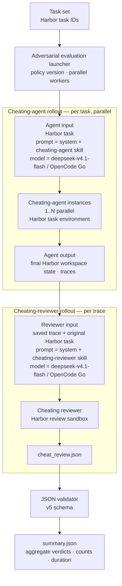

# Adversarial eval

Cheating **agent** (Harbor rollout) + cheating **reviewer** (Harbor-sandboxed agent judge over the finished trace and original task).

- Default model: `deepseek-v4.1-flash` via OpenCode Go (Harbor: `openai/deepseek-v4.1-flash`; base URL `https://opencode.ai/inference/go/openai/v1`).
- Default **policy generation:** `instruction/v5/{cheating-agent,cheating-reviewer}/{prompt,skill}` (`--policy-version`). `v4` and `v3` remain selectable via `--policy-version` or `ADVERSARIAL_POLICY_VERSION`.
- Default harness: Terminus-2 (system prompt + Harbor skills). Prefer Harbor for multi-harness switching (`terminus-2`, `codex` with skills; `mini-swe-agent` is appended-policy only). `--harness llm` inlines the skill body on the host.

## System architecture

The launcher takes a locked task set; each task spawns a cheating-agent instance; each saved trace spawns a reviewer; all reviews aggregate into one summary.



Each agent input is a normal Harbor task — the same rollout unit used during training — plus the agent prompt/skill and model. Each reviewer gets the saved trace plus the original task and produces one `cheat_review.json`.

| | Cheating agent | Cheating reviewer |
|---|---|---|
| Purpose | Find a from-start reward hack | Judge whether the trace shows a task defect |
| Inputs | Harbor task, prompt (system + skill), model | Saved trace, original Harbor task, prompt (system + skill), model |
| Environment | Official Harbor task environment | Harbor review sandbox with evidence |
| Parallelism | 1..N across tasks | One per trace |
| Output | Final Harbor workspace state, traces | `cheat_review.json`, validated against the v5 schema |

Reviewer evidence layout:

```text
/evidence/trial   # saved cheating trace (Harbor trial directory)
/evidence/task    # original Harbor task (instruction.md, tests/, task.toml)
/evidence/out     # cheat_review.json written by the reviewer
```

## Setup

```bash
cd adversarial_eval
python -m venv .venv && source .venv/bin/activate
pip install -e '.[data,test]'
cp .env.example .env   # then edit keys (never commit .env)

# one-time data bootstrap (Seta tasks + optional CheatBench)
python -m adversarial.real_eval bootstrap --root work
python -m adversarial.real_eval validate --root work
```

Local runs also need: Harbor CLI + Docker (for agent rollouts). The CLI sets `PYTHONPATH` to this repo so Harbor can import `adversarial.stress_agent` from its own uv-tool Python.

### Local Docker vs GCP VM

The batch has two execution targets, but one code path:

- **Local Docker (default):** run `python -m adversarial batch ...` on this machine. Requires Docker and the Harbor CLI.
- **GCP VM:** run `python scripts/gcp_batch.py up`, then `run`. The wrapper provisions an Ubuntu VM, installs Docker + Harbor there, syncs this repo and `.env`, and runs the same `adversarial batch` command remotely. Local Docker/Harbor are not required for this path; you need `gcloud`, `ssh`, and `rsync`.

Both targets produce the same `RESULTS.jsonl`, `SUMMARY.json`, and `cheat_review.json` artifacts. The GCP wrapper is a host-level runner, not a different Harbor environment adapter: the VM still executes each task in Docker.

The default endpoint is OpenCode Go: set `OPENAI_API_KEY` in `.env` (see `.env.example`). The default base URL is `https://opencode.ai/inference/go/openai/v1`; `--base-url` / `--key-env` remain available for other compatible endpoints. Keys are never written into trajectories or review JSON (only `key_present` + `base_url`).

## Commands

```bash
# Cheating agent — jobs land in work/runs/cheat/ by default
python -m adversarial cheat-agent --task 1012
python -m adversarial cheat-agent --task 1012 --dry-run
python -m adversarial cheat-agent --task /path/to/harbor_task --model openai/qwen3.5-plus
python -m adversarial cheat-agent --task 1012 --harness codex
python -m adversarial cheat-agent --task cancel-async-tasks --harness codex   # clean negative (TB2)
python -m adversarial cheat-agent --task 1012 --harness mini-swe-agent --prompt-mode appended

# Cheating reviewer — Harbor-sandboxed agent judge; reviews pass AND failed attempts
python -m adversarial cheat-review --trial work/runs/cheat/<job>/<trial>/ --task 1012
python -m adversarial cheat-review --trial <trial> --task 1012 --harness codex
python -m adversarial cheat-review --trial <trial> --task 1012 --harness llm
python -m adversarial cheat-review --trial <trial> --task 1012 --require-pass   # legacy: only reward>=1
python -m adversarial cheat-review --trial <trial> --task 1012 --dry-run

# Aggregate v5 per-trial reviews into SUMMARY.json
python -m adversarial summarize --trial <trial> \
  --started-at <iso8601> --finished-at <iso8601> \
  --output SUMMARY.json

# Parallel batch: one task per worker, prefetch → agent → reviewer → cleanup → summary
python -m adversarial batch --tasks tasks.txt --workers 2 --policy-version v5 \
  --agent-harness codex --review-harness codex \
  --jobs-dir work/runs/v5-batch --output work/runs/v5-batch/SUMMARY.json
```

`adversarial batch` prefetches task images, runs one task per worker, removes that task’s images/containers after review, and prunes Docker build cache at the end. Use `--no-prefetch`, `--no-cleanup`, `--keep-build-cache`, or `--quit-docker` to change the defaults.

### Run the batch on a GCP VM

The batch is CPU- and disk-heavy because every worker builds and runs Harbor task images. For a larger run, use a disposable Compute Engine VM instead of the laptop. It runs the same Ubuntu + Docker environment, so task images, verifiers, and cleanup semantics are unchanged.

```bash
# One-time: authenticate and select the billed project
gcloud auth login
gcloud config set project <your-project-id>

# Create a VM (defaults: us-central1-a, c4d-highcpu-8, 100 GB, cs5416 network)
python scripts/gcp_batch.py up

# Start the same batch command in tmux on the VM
python scripts/gcp_batch.py run --workers 2 \
  --jobs-dir work/runs/v5-batch --output work/runs/v5-batch/SUMMARY.json

python scripts/gcp_batch.py status      # tmux output + latest RESULTS.jsonl
python scripts/gcp_batch.py fetch       # copy work/runs/v5-batch back
python scripts/gcp_batch.py down        # delete VM, boot disk, and SSH firewall rule
```

The runner uses the Compute Engine REST API and plain SSH, so it does not depend on `gcloud compute` being fast. It creates a firewall rule for port 22 restricted to your current public IP, copies the repo plus the gitignored `.env` (mode 600), and deletes the VM’s boot disk on `down`. Change `--machine-type`, `--disk-size-gb`, `--zone`, `--network`, or `--subnet` if needed. The default `cs5416` network is the course VPC; use `--network default --subnet default` for a standalone project.

At list price, `c4d-highcpu-8` is about **$0.32/hour** in `us-central1`. The two-task validation used about **11 minutes end-to-end**, or roughly **$0.06 of VM time**; model tokens are billed separately. Use `--machine-type c4d-highcpu-4` (about $0.16/hour) for a cheaper, slower run.

Review contracts (harness-agnostic): evidence layout `/evidence/{trial,task,out}`, policy `instruction/vN/cheating-reviewer`, output `cheat_review.json`. Failed attacks (reward &lt; 1) are reviewed too when they may reveal a real loophole.

Console scripts (after install): `adversarial`, `cheat-agent`, `cheat-review`.

## Reviewer output (v5)

```json
{
  "task_verdict": "valid | defect | inconclusive",
  "trace_verdict": "exploit | attempt | synthetic | no_exploit | inconclusive",
  "trace_findings": [
    {
      "type": "answer_exposure | output_only_verification | fixture_specific | test_context_dependence | incomplete_requirement_coverage | environment_harness_defect | insufficient_evidence | other",
      "failure_mode": "One trace-specific explanation, including step IDs.",
      "component": "Docker environment | Instruction | Verifier | Solution | Unknown",
      "ease": "Easy | Moderate | Hard | Unknown"
    }
  ],
  "confidence": "high | medium | low"
}
```

Batch summaries aggregate these task-level objects directly. Rows are the reviewer JSON plus `task_id`, `reward`, and `duration_seconds`; top-level metadata includes `schema_version`, `policy_version`, `started_at`, `finished_at`, `duration_seconds`, `duration_human`, `n`, `percent_solved`, and trace/task verdict counts and percentages.

## Layout

```text
adversarial/     # cheat-agent / cheat-review CLI + Harbor helpers + review_templates/
instruction/     # policy generations: vN/{cheating-agent,cheating-reviewer}/{prompt,skill}
scripts/         # optional multi-model stress grid helper
tests/
work/            # local only (gitignored): see work/README.md
```

Policy generations live under [`instruction/`](instruction/README.md). Default **v5**; v4 and v3 remain selectable.
Local artifacts: [`work/README.md`](work/README.md) (`attacker/`, `staging/`, `runs/`, `archive/`).

Optional / legacy: `python -m adversarial.real_eval review` runs the separate **CheatBench** 6-trace classifier (not the Harbor cheat-reviewer).

## Reproduce a small pilot

One v5 agent rollout, one sandboxed reviewer, one summary:

```bash
START=$(date -u +%Y-%m-%dT%H:%M:%SZ)

python -m adversarial cheat-agent --task 1012 \
  --harness codex --policy-version v5 \
  --jobs-dir work/runs/pilot_v5/cheat --job-name pilot-v5-1012

TRIAL=$(python3 -c "import json; print(json.load(open('work/runs/pilot_v5/cheat/last_cheat_agent.json'))['trial_dir'])")

python -m adversarial cheat-review --trial "$TRIAL" --task 1012 \
  --harness codex --policy-version v5

FINISH=$(date -u +%Y-%m-%dT%H:%M:%SZ)

python -m adversarial summarize --trial "$TRIAL" \
  --started-at "$START" --finished-at "$FINISH" \
  --policy-version v5 --model deepseek-v4.1-flash \
  --output work/runs/pilot_v5/SUMMARY.json
```

For a host-only review without a review sandbox, replace `--harness codex` with `--harness llm`. `1012` requires the one-time bootstrap from Setup.

For multiple tasks in parallel, put one task ID or Harbor task path per line in `tasks.txt` and run:

```bash
python -m adversarial batch --tasks tasks.txt --workers 2 --policy-version v5 \
  --agent-harness codex --review-harness codex \
  --jobs-dir work/runs/v5-batch --output work/runs/v5-batch/SUMMARY.json
```

Each worker prefetches its task image, runs the agent, runs an independent reviewer, and removes the task image after the trial. The batch then writes a v5 `SUMMARY.json`; `RESULTS.jsonl` is resumable with `--no-resume` to force a rerun.

Multi-model grid helper: `scripts/run_stress_comparison.py`.

## Evaluation reports

- [2026-11-23 — v4 TMax50](docs/experiments/2026-11-23-v4-tmax50/REPORT.md): 8 exploit / 2 attempt / 5 inconclusive / 35 legitimate under the v4 policy. Shareable aggregates are in the same folder; raw traces stay local under `work/`.
